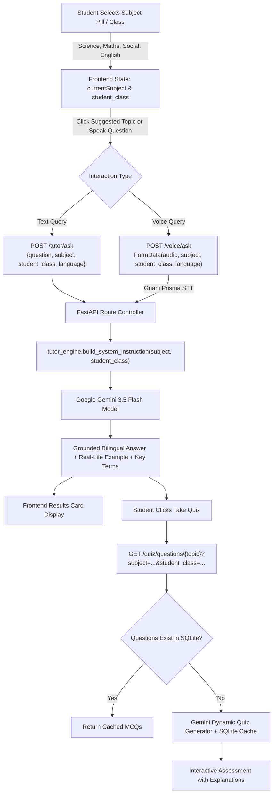

# VidyaMitra Multi-Subject & Multi-Grade Expansion Documentation

> **Document Purpose**: This document provides a complete, granular reference of all modifications, code locations, file paths, and architectural decisions made to expand VidyaMitra beyond Class 8 Science to seamlessly support **Classes 6 through 10** across four foundational school subjects: **Science, Mathematics, Social Studies, and English**.

---

## 1. Architectural Strategy: Simplicity vs Complexity

### The Challenge
Expanding VidyaMitra to cover multiple grades (6, 7, 8, 9, 10) and multiple subjects (Science, Mathematics, Social Studies, English) could easily lead to **high architectural complexity**:
- Hardcoding static JSON curriculum files for 5 classes × 4 subjects = **20+ individual curriculum files**.
- Complex rule engines and difficult maintenance as textbooks evolve.

### The Solution: Dynamic Prompt Adaptation & Dynamic Quiz Generation
Instead of unmaintainable static files, VidyaMitra leverages:
1. **Adaptive System Instruction Engine**: Google Gemini Flash possesses comprehensive innate knowledge of NCERT/SCERT state and national syllabi. By dynamically injecting the target **Subject**, **Grade Level**, and **Pedagogical Persona** into the prompt, the tutor autonomously calibrates explanation depth, daily-life examples, and key vocabulary.
2. **Subject Selector UI**: Interactive Subject Pills in the frontend (Science, Mathematics, Social Studies, English) that switch suggested topics and update the active learning context instantly without requiring page reloads.
3. **Dynamic Multi-Subject Quiz Engine**: When a student launches a quiz for a non-seeded subject topic (like *Algebra* or *Indian Constitution*), SQLite checks if cached questions exist. If not, it generates 2 multi-choice questions in real-time, persists them to SQLite for future fast lookup, and provides an offline conceptual fallback.

---

## 2. Granular Code Changes by File

### 1. `app/services/tutor_engine.py`
- **Location**: `app/services/tutor_engine.py`
- **Purpose**: Dynamic system instruction builder and multi-subject LLM routing.
- **Key Functions Modified**:
  - `build_system_instruction(subject: str, student_class: str) -> str`:
    - Generates customized system prompts for each subject:
      - **Science**: Focuses on natural phenomena, scientific method, and everyday physical observations.
      - **Mathematics**: Emphasizes step-by-step problem solving, formulas, and real-world calculation scenarios.
      - **Social Studies**: Explains geography, history, civics, governance, and environment with regional Indian/Andhra context.
      - **English**: Covers grammar, tenses, vocabulary, parts of speech, and sentence formation.
  - `generate_tutor_response(question, language, subject, student_class, previous_topic, conversation_history)`:
    - Updated parameter list to accept `subject: str = "Science"` and `student_class: str = "Class 8"`.
    - Routes the request through `build_system_instruction(...)` while retaining curriculum fallback matching for backward compatibility.

---

### 2. `app/routes/tutor.py`
- **Location**: `app/routes/tutor.py`
- **Purpose**: FastAPI route controller for text-based AI tutoring.
- **Key Code Modified**:
  - `QuestionRequest` Pydantic model:
    ```python
    class QuestionRequest(BaseModel):
        question: str
        language: str = "te"
        subject: Optional[str] = "Science"
        student_class: Optional[str] = "Class 8"
        previous_topic: Optional[str] = None
        conversation_history: Optional[List[Dict[str, str]]] = None
    ```
  - `ask_question(...)`: Passes `subject` and `student_class` directly to `generate_tutor_response`.
  - `topics(subject: Optional[str] = "Science")`: Accepts `subject` query parameter.

---

### 3. `app/routes/voice.py`
- **Location**: `app/routes/voice.py`
- **Purpose**: Full vertical voice interaction endpoint.
- **Key Code Modified**:
  - `voice_ask(...)`:
    ```python
    @router.post("/ask")
    async def voice_ask(
        audio_file: UploadFile = File(...),
        language: str = Form("te"),
        subject: str = Form("Science"),
        student_class: str = Form("Class 8"),
        play_audio: bool = Form(True),
        previous_topic: Optional[str] = Form(None)
    ):
    ```
  - Forwards `subject` and `student_class` to `generate_tutor_response`.
  - Maintains 100% compatibility with Gnani Prisma STT (`te-IN`) and Gnani Timbre TTS (`Suhana`).

---

### 4. `app/services/database.py`
- **Location**: `app/services/database.py`
- **Purpose**: Dynamic quiz fetching and on-demand MCQ generation.
- **Key Functions Modified**:
  - `get_quiz_by_topic(topic_id, language, subject, student_class)`:
    - Queries SQLite for cached questions.
    - If none exist, delegates to `generate_dynamic_quiz_questions`.
  - `generate_dynamic_quiz_questions(topic_name, language, subject, student_class)`:
    - Calls Gemini API with structured JSON output requesting 2 grade-appropriate MCQs, options, correct answers, and bilingual explanations.
    - Caches questions into `quiz_questions` table for instant future reuse.
    - Includes an offline conceptual fallback if the API is offline or without an API key, ensuring students always receive an interactive assessment.

---

### 5. `app/routes/quiz.py`
- **Location**: `app/routes/quiz.py`
- **Purpose**: Assessment API endpoint for topic quizzes.
- **Key Code Modified**:
  - `fetch_quiz(topic_id, language, subject, student_class)`:
    ```python
    @router.get("/questions/{topic_id}")
    async def fetch_quiz(
        topic_id: str,
        language: str = "te",
        subject: str = "Science",
        student_class: str = "Class 8"
    ):
    ```
  - Retrieves questions tailored to the requested subject and grade.

---

### 6. `app/static/index.html`
- **Location**: `app/static/index.html`
- **Purpose**: Multi-subject UI controls and registration grade selector.
- **Key Elements Added**:
  - **Subject Selector Bar** (inside `.topics-section`):
    ```html
    <div class="subject-selector-bar">
      <span class="subject-bar-label" id="lbl-select-subject">విషయాన్ని ఎంచుకోండి (Choose Subject):</span>
      <div class="subject-pills" id="subject-pills" role="tablist">
        <button type="button" class="subject-pill active" data-subject="Science" id="subj-science">
          <span class="subj-icon">🌿</span>
          <span class="subj-name">సైన్స్ (Science)</span>
        </button>
        <button type="button" class="subject-pill" data-subject="Mathematics" id="subj-maths">
          <span class="subj-icon">📐</span>
          <span class="subj-name">గణితం (Maths)</span>
        </button>
        <button type="button" class="subject-pill" data-subject="Social Studies" id="subj-social">
          <span class="subj-icon">🌍</span>
          <span class="subj-name">సాంఘిక శాస్త్రం (Social)</span>
        </button>
        <button type="button" class="subject-pill" data-subject="English" id="subj-english">
          <span class="subj-icon">📖</span>
          <span class="subj-name">ఇంగ్లీష్ (English)</span>
        </button>
      </div>
    </div>
    ```
  - **Class Selector Options** (inside `#reg-class` dropdown):
    - Added Class 6, Class 7, Class 8, Class 9, and Class 10 with bilingual labels.

---

### 7. `app/static/style.css`
- **Location**: `app/static/style.css`
- **Purpose**: Styling for subject pills and multi-subject layout.
- **Key Classes Added**:
  - `.subject-selector-bar`: Horizontal container with gap and align-items.
  - `.subject-bar-label`: Bold typography in brand dark green (`#002204`).
  - `.subject-pills`: Flex container for subject toggle buttons.
  - `.subject-pill`: Pill styling with smooth transitions, border radius 20px, and subtle border.
  - `.subject-pill:hover`: Interactive scale effect (`transform: translateY(-2px)`).
  - `.subject-pill.active`: Active state with brand green background (`var(--brand-green)`), white text, and box shadow.

---

### 8. `app/static/app.js`
- **Location**: `app/static/app.js`
- **Purpose**: Frontend application state, dynamic chip rendering, and API parameter bindings.
- **Key Logic Added**:
  - `SUBJECT_TOPICS` Map: Pre-configured prompt bank for Science, Mathematics, Social Studies, and English in both Telugu and English.
  - `currentSubject` state variable (defaults to `'Science'`).
  - `getStudentClass()`: Reads the logged-in student's class from `localStorage` (default: `'8వ తరగతి (Class 8)'`).
  - `renderTopicChips()`: Generates one-click prompt buttons matching the active subject and language.
  - `subjectPills` click listeners: Updates `currentSubject`, toggles `.active` class, and re-renders chips.
  - `setLanguage(lang)`:
    - Synchronizes subject bar labels (`#lbl-select-subject`).
    - Updates `.subj-name` labels on pills.
    - Re-renders topic chips in the selected language.
  - `submitTextQuestion(query)`: Sends `subject` and `student_class` in JSON body.
  - `uploadVoiceQuestion(audioBlob, mimeType)`: Appends `subject` and `student_class` to `FormData`.
  - `loadQuiz(topic)`: Appends `subject` and `student_class` to query parameters.

---

## 3. Data Flow Diagram



---

## 4. Verification and Testing

### 1. Verification of System Instructions & Fallback
Run the Python test script from the project root:
```bash
python -c "
from app.services.tutor_engine import build_system_instruction
from app.services.database import get_quiz_by_topic

# Test Math Grade 9
sys_math = build_system_instruction('Mathematics', 'Class 9')
assert 'Mathematics' in sys_math and 'Class 9' in sys_math

# Test Dynamic Quiz fallback
q = get_quiz_by_topic('Algebra', language='te', subject='Mathematics', student_class='Class 9')
assert len(q) >= 2
print('Verification successful!')
"
```

### 2. Manual UI Testing
1. Launch the server:
   ```bash
   python -m uvicorn app.main:app --host 127.0.0.1 --port 8000
   ```
2. Open `http://localhost:8000`.
3. Log in or click **"🚀 Explore as Guest"**.
4. Click on the **"📐 గణితం (Maths)"** pill:
   - Notice that the topic chips instantly update to Algebra, Linear Equations, Fractions, and Geometry.
5. Click on any chip (e.g. Fractions) or ask a question:
   - VidyaMitra provides a step-by-step mathematical explanation tailored to the student's grade.
6. Click **"🎯 ఈ పాఠంపై క్విజ్ రాయండి (Take Quiz)"**:
   - Dynamic multiple-choice questions for the topic are displayed with instant feedback.
7. Switch language to **English** using the top-right toggle:
   - The subject pills, instructions, questions, and quiz options instantly switch to English.

---

## 5. Summary of Files Changed

| File | Change Description |
|---|---|
| `app/services/tutor_engine.py` | Added `build_system_instruction`, multi-subject & grade-level prompt adaptation |
| `app/routes/tutor.py` | Added `subject` and `student_class` to `QuestionRequest` schema and endpoint |
| `app/routes/voice.py` | Added `subject` and `student_class` Form fields to `/voice/ask` |
| `app/services/database.py` | Added dynamic multi-subject MCQ generation with SQLite caching and offline fallback |
| `app/routes/quiz.py` | Added `subject` and `student_class` parameters to `/quiz/questions/{topic_id}` |
| `app/static/index.html` | Added `.subject-selector-bar`, `#subject-pills`, and Grades 6–10 dropdown |
| `app/static/style.css` | Styled subject pills, active states, hover transitions, and responsive layout |
| `app/static/app.js` | Dynamic topic chip rendering, subject selection, and API parameter synchronization |
| `docs/MULTI_SUBJECT_EXPANSION.md` | Full architecture documentation, file list, and verification instructions |
